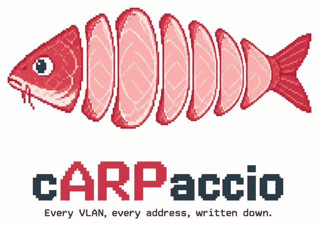

<p align="center">
  
</p>

# cARPaccio

**Every VLAN, every address, written down — and kept written down by an agent.**

cARPaccio is a document describing your network, with an HTTP API built for
something else to maintain it. The sheet you can open in a browser is for
*reading*. The API is the product.

The name is styled **cARPaccio** — ARP, sliced thin.

## How it is meant to be used

You say what is wrong. The agent reads the document, works out what changed,
and writes it. You do not open the sheet and you do not edit config.

> **"I don't see the new host."**
>
> The agent read `GET /api/devices`, found two machines absent, checked
> `GET /api/vlans/home/free` and saw their addresses were still being offered
> as free to hand out — to machines already using them. It collected the MACs
> over SSH, `POST`ed both as `assignment: static` with a note saying where the
> address really lives, and reported back: two rows added, free count 36 → 34.
>
> That is a real session. The owner never opened the page.

Everything below serves that loop. If you are wiring an agent up, you want
**[SKILL.md](SKILL.md)** — it is written for the agent, not about it.

## Why it exists

**A network's real state is never in one system, and the parts no system
knows are the parts that bite.**

- **Addresses a host holds by its own configuration** (`assignment: static`)
  appear in no controller, no lease table and no API. A dozen cluster nodes
  pinning `192.168.1.212–224` are invisible — and they are exactly the
  addresses at risk of being handed out twice.
- **Addresses no device owns at all**: a virtual IP, a load-balancer pool.
  ARP attributes them to whichever machine answered last, and during a
  failover nothing answers, so "is this address free?" says **yes** about the
  address your cluster's API lives on. That nearly happened here.
- **Which clients sit on a randomised MAC** — the locally-administered bit,
  computed from the address itself, not a vendor list. A DHCP reservation on
  one of those silently stops applying.
- **A network with zero firewall rules looks exactly like a segmented one**
  until somebody draws the matrix.

None of that is a gap in any particular vendor. It is the difference between
what machines report and what is true, and closing it needs something that
writes things down.

## How it works

- **FastAPI** backend, server-rendered Jinja2 + a small amount of plain
  JavaScript. No node, no build step.
- **State is one JSON document in S3 (MinIO).** Not a database, not git. The
  bucket has object versioning switched on — that *is* the history/rollback
  mechanism.
- **Two writers never clobber each other.** Every read hands out a version
  token; every write must present it. A stale write is refused with HTTP 409
  and a description of what changed — never silently merged. Last-writer-wins
  on a firewall table is how a VLAN quietly stops being separated.
- **Every write is validated against a JSON Schema**
  (`src/carpaccio/schema/network.schema.json`, `GET /api/schema`). An invalid
  document is refused with 422 and the stored object is left untouched.

## Reserved addresses — the ones no device owns

Some addresses are in use and belong to no machine: a virtual IP that floats
between nodes, a load-balancer pool handed out to services. They are invisible
to everything else this tool reads.

- **No controller reports them.** There is no lease and no device record.
- **ARP attributes them to whichever machine answered last**, so they read as a
  duplicate of a host already in the inventory.
- **They can be completely silent.** During a failover, or when nothing has
  spoken to one recently, there is no ARP entry at all.

That last case is why this section exists. "Is this address free?" would answer
**yes** about an address that is very much in use. On 2026-09-24 the Kubernetes
API VIP at `192.168.1.230` was nearly handed to a new node; it was caught only
because a pre-flight ping happened to answer, and answered as the machine that
held the VIP at that moment.

Put them in the **DHCP ranges** tab, under *Reserved — addresses no device
owns*. They are excluded from every free-address answer, and an import never
drops them. They also appear, read-only, in the **All** tab below — because
somebody looking for `.230` types the number, and is not thinking "that will be
filed under DHCP ranges".

**This list is hand-maintained, and that is the honest answer rather than a
limitation to apologise for.** An address no API reports is one a human has to
write down, which is the same reason the tool already carries an
`assignment: static` case for host-configured addresses.

## The All tab, and searching for an address

Each VLAN gets its own tab, which answers *what is on this segment*. The **All**
tab answers the other question — *where is this address* — with every VLAN in
one table, a VLAN column, and one filter box over the lot. Reserved addresses
are in that table too, read-only and marked; they are edited on the DHCP ranges
tab, which stays their home.

There is no *+ Add device* on the All tab, on purpose: a device belongs to a
VLAN, and this table spans all of them, so there is no honest answer to which
one a new row would join.

**The filter box reads a number as one whole octet, in any position.**

| You type | It finds |
|---|---|
| `230` | `192.168.1.230`, and `10.0.230.4` — any octet that IS 230 |
| `2` | `192.168.1.2`, and **not** `192.168.1.25` |
| `192.168.1.` | the whole /24 (a trailing dot is an explicit prefix) |
| `192.168.1.2` | that address only, never `.25` |
| `printer` | name, hostname and MAC, case-insensitively |

The rule being protected is the **octet boundary**: `.2` must never match `.25`,
because that is precisely the wrong row to show somebody checking whether `.2`
is free. A bare number matching any position is new (0.7.0) — reading one as a
prefix made the box useless on a network where every address starts `192.168.1`,
and it is how `.230` looked absent from the document when it had been recorded
all along.

A reserved **range** answers for every address inside it: `242` finds the
MetalLB pool written as `.240`–`.244`, even though 242 appears nowhere.

## Quickstart

```sh
docker compose up
```

brings up MinIO, creates the versioned bucket, and serves the sheet on
<http://localhost:8000>. First run shows an empty document — not an error.

### Sources

The document is the product; a source is a plugin that fills part of it.
**UniFi is the one that ships**, because it is what the author runs — not
because cARPaccio is a UniFi tool. Nothing in the schema, the API or the UI
knows what a UniFi is; an importer is just something that produces a valid
document and merges it.

Whatever your network runs — OPNsense, Mikrotik, a pile of static leases, or
nothing at all — you can fill this by hand, by agent, or by writing an
importer against `GET /api/schema`. A row's `source` field records where it
came from, and `merge()` never lets an import overwrite what a human or an
agent wrote: hand-added `static` devices and the whole `reserved` section
survive every re-import, by design.

To fill it from a UniFi controller (UDM / UDM SE, UniFi OS on port 443):

```sh
export UNIFI_HOST=192.168.1.1 UNIFI_USER=readonly UNIFI_PASSWORD=...
uv run carpaccio-import            # merges into the stored document
uv run carpaccio-import --dry-run  # prints the parsed document instead
```

The importer is **read-only against the controller** (the login POST is the
only non-GET it ever sends) and **merges, keyed on MAC**: hand-written
notes, names and `static` entries survive every re-import.

## Environment variables

| Variable | Default | Purpose |
|---|---|---|
| `CARPACCIO_S3_ENDPOINT` | — | MinIO/S3 endpoint URL |
| `CARPACCIO_S3_ACCESS_KEY` | — | S3 access key |
| `CARPACCIO_S3_SECRET_KEY` | — | S3 secret key |
| `CARPACCIO_S3_BUCKET` | `carpaccio` | Bucket (versioning should be enabled) |
| `CARPACCIO_S3_KEY` | `network.json` | Object key of the document |
| `UNIFI_HOST` | — | Importer only: controller host (port 443) |
| `UNIFI_USER` | — | Importer only: controller username |
| `UNIFI_PASSWORD` | — | Importer only: controller password |

Credentials come from the environment only — never from flags, files in this
repo, or defaults. Auth adds three more:

| Variable | Default | Purpose |
|---|---|---|
| `CARPACCIO_BASIC_USER` / `CARPACCIO_BASIC_PASSWORD_HASH` | — | see [Security](#security); both unset = auth off |
| `CARPACCIO_SESSION_SECRET` | — | signs the browser session cookie. Unset does not stop the boot: a random per-boot secret is used and a log warning says sessions will not survive a restart |
| `CARPACCIO_COOKIE_SECURE` | auto | force the session cookie's `Secure` flag (`true`/`false`). Auto = on exactly when the request arrived over HTTPS (`X-Forwarded-Proto` when the proxy sets it, else the request scheme) |

## API

**The contract is the whole document.** `GET /api/network` hands out a
version token; `PUT /api/network` must present it; a stale write is refused
with 409 and a description of what changed. Everything else is convenience
on top of that contract — each per-resource write reads the document, applies
one change, and saves against the version it just read, so it conflicts
exactly like the whole-document PUT. There is deliberately no server-side
retry on conflict: on a 409, re-read and redo.

| Route | What it does |
|---|---|
| `GET /` | the sheet UI |
| `GET /healthz` | liveness, plus whether S3 answers |
| `GET /api/network` | `{version, document}` — version is the lock token |
| `GET /api/network?version=<id>` | one historical version: `{version_id, historical, document}` (no lock token, on purpose) |
| `PUT /api/network` | `{version, document}` — 409 on a stale version, 422 on an invalid document |
| `GET /api/schema` | the JSON Schema the server validates with |
| `GET /api/history` | stored versions, newest first, each with a plain-English summary of what it changed |
| `GET /api/{vlans,devices,wans,infrastructure,firewall_rules}` | one section plus the current version token |
| `GET /api/vlans/{name}/free` | addresses safe to hand out on that VLAN: inside the subnet, outside the DHCP pool, not the gateway, not on any device or gear. Collapsed ranges plus a count; `reason` says why when there is no answer |
| `POST /api/devices` | add a device (body = the device object; 409 if the MAC exists) |
| `PATCH /api/devices/{mac}` | update some fields of one device |
| `DELETE /api/devices/{mac}` | remove one device |
| `POST /api/vlans` | add a VLAN (always stored as `source: manual`) |
| `PATCH /api/vlans/{name}` | update a VLAN; renaming follows the rules below |
| `DELETE /api/vlans/{name}` | remove a VLAN — refused with 409 while devices still reference it |
| `POST /api/firewall_rules` | add a rule (an `id` is minted if absent) |
| `PATCH /api/firewall_rules/{id}` | update one rule |
| `DELETE /api/firewall_rules/{id}` | remove one rule |

Two rules the API enforces rather than documents away:

- **A UniFi VLAN cannot be renamed here** (409): its name is the merge key on
  re-import, and renaming it would duplicate the segment instead. Rename it
  on the controller. Every other field of a UniFi VLAN edits freely.
- **A VLAN with devices on it cannot be deleted** (409, with the count):
  deleting it would orphan those rows off every tab. Move or delete the
  devices first — nothing is dropped silently.

Per-resource writes accept an optional `If-Match: <version>` header to pin
the write to a version read earlier; without it the write is pinned to the
version read inside the request. Either way a concurrent save produces a 409,
never a lost update.

### Worked examples

```sh
BASE=http://localhost:8000

# read one section (the version token rides along)
curl -s $BASE/api/vlans | jq

# add a static entry the controller will never know about
curl -s -X POST $BASE/api/devices -H 'Content-Type: application/json' -d '{
  "mac": "02:00:00:00:00:01", "name": "k3s node pi7",
  "ip": "192.168.1.218", "vlan": "home", "assignment": "static"
}' | jq

# annotate a device / fix a wrong field
curl -s -X PATCH $BASE/api/devices/02:00:00:00:00:01   -H 'Content-Type: application/json' -d '{"notes": "rack 2, top"}' | jq

# add a firewall rule; the id comes back minted
curl -s -X POST $BASE/api/firewall_rules -H 'Content-Type: application/json' -d '{
  "name": "guest cannot reach home", "action": "drop", "src": "guest", "dst": "home"
}' | jq

# an agent that wants the strict mode: pin the write to a version it read
V=$(curl -s $BASE/api/network | jq -r .version)
curl -s -X DELETE $BASE/api/devices/02:00:00:00:00:01 -H "If-Match: $V" | jq

# history, and reading one old version
curl -s $BASE/api/history | jq '.versions[0]'
curl -s "$BASE/api/network?version=<version_id>" | jq .document

# validate before writing: the served schema is the one the server enforces
curl -s $BASE/api/schema > network.schema.json
# ... check your document against it (e.g. python -m jsonschema, ajv) ...
```

Restoring an old version is a normal save: `GET /api/network?version=<id>`
for the content, `GET /api/network` for the current token, then `PUT` the old
content with that token. It lands as a **new** version — history is never
rewritten or deleted, and the History tab's Restore button does exactly this.

## Security

**Two doors, one lock.** Scripts and agents authenticate with HTTP Basic;
a browser gets a real login form at `/login` and carries a signed session
cookie afterwards (`HttpOnly`, `SameSite=Lax`, one-week expiry, `Secure`
whenever the request actually arrived over HTTPS). Both paths satisfy the
same middleware, and the split is precise: an unauthenticated **API-shaped**
request (path under `/api/`, or no `text/html` preference) always gets the
401 JSON with `WWW-Authenticate` — never a redirect, so an agent can never
mistake a login page for data. Only a browser navigation is sent to the form,
and returns to where it was heading. Log out with the header button; agents
on Basic are unaffected.

Set two environment variables and auth is on; leave either unset and it is
**off**, which is fine on a laptop but never silent — `/healthz` reports
`"auth": "off"` so an unauthenticated instance is a thing you can see rather
than a thing you have to remember.

```bash
CARPACCIO_BASIC_USER=waw
CARPACCIO_BASIC_PASSWORD_HASH='$2b$12$...'     # bcrypt, never a password
```

Generate the hash with `htpasswd -nbBC 12 <user> <password>` (take the part
after the colon) or:

```bash
python -c 'import bcrypt,sys; print(bcrypt.hashpw(sys.argv[1].encode(), bcrypt.gensalt(12)).decode())' 'your password'
```

**`/healthz`, `/login` and `/static/*` are deliberately open.** Kubernetes
liveness and readiness probes send no credentials; behind auth they get 401,
the pod is declared unhealthy, and a working app is restarted for ever.
`/login` must be reachable or nobody can ever log in, and `/static/*` is the
login page's own stylesheet — committed CSS/JS from a public repo, nothing to
guard.

**What Basic auth is and is not.** It is a password over TLS, appropriate for
one household on one LAN. It is not per-user identity, it has no audit trail
beyond the change history, and every caller shares one credential — including
any agent using the API. Do not put this on the public internet and consider
the password sufficient.

**The fixtures in this repo are synthetic.** `tests/fixtures/sanitise.py`
generates them; no real MAC, address or device name from anyone's network is
committed here. The real data lives only in object storage.


## Development

The logo and icon art live in `docs/images/` (full-size originals, not shipped).
The browser icons in `src/carpaccio/static/` and the README logo are generated
from them — after changing the art, run `python3 scripts/make_icons.py`
(needs Pillow) and commit the output.

```sh
uv sync --all-groups
uv run pytest
uv run ruff check . && uv run ruff format --check .
```

The test fixtures under `tests/fixtures/unifi/` are **synthetic**: generated
by `tests/fixtures/sanitise.py` from real controller responses that never
entered the repo. They keep the exact structure and counts of the real API
payloads (87 clients, 17 reservations, 8 active randomised MACs, an empty
firewall-policy list) with every MAC, address, name, token and coordinate
replaced. The real data lives only in the owner's S3 bucket.

## Deploying to Kubernetes

The chart is in `charts/carpaccio`. The image is published to **GHCR** by
`.github/workflows/release.yml` when a `v*` tag is pushed: multi-arch
(amd64 + arm64), with build provenance and an SBOM attached.

```sh
git tag v0.8.0 && git push origin v0.8.0
# -> ghcr.io/wawrepo/carpaccio:v0.8.0  (+ :latest)
```

**The package is public even though this repository is not.** Those are two
separate settings on GHCR, and separating them is deliberate: nodes pull
anonymously with no pull secret, while the source stays private. Publishing
the code is a different decision and has not been taken.

Pin by digest in whatever deploys it — the workflow prints the exact line in
its run summary. A tag can be moved; a digest cannot, so what runs is what was
built and attested.

**A release shows up on a normal reload.** Every `/static` link carries a
fingerprint of the file's content (`app.js?v=<12 hex>`), so a changed file is
a new URL that can be cached for ever, and the pages themselves are sent with
`Cache-Control: no-cache`. Link static files through `static_url()` in the
templates, never as a bare `/static/...` path — a test fails if you do.

A Helm chart lives in `charts/carpaccio/`. The pod is stateless (all state is
in S3), so it carries no PVC and no nodeSelector and can schedule on any
node. S3 credentials are read from an existing Secret — see
`charts/carpaccio/values.yaml`.
